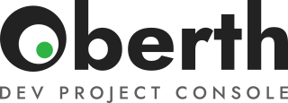
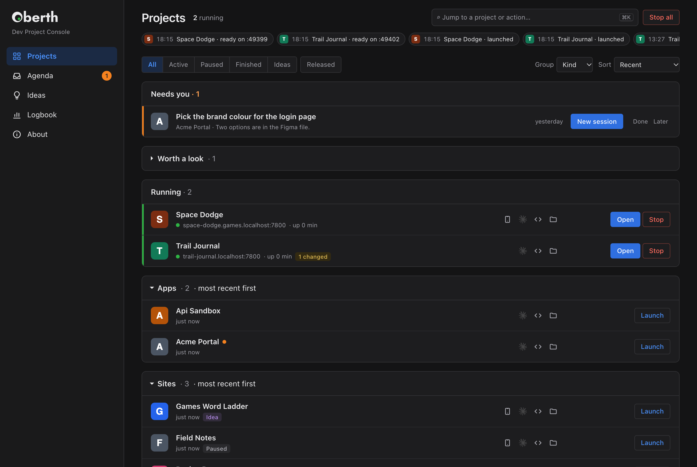
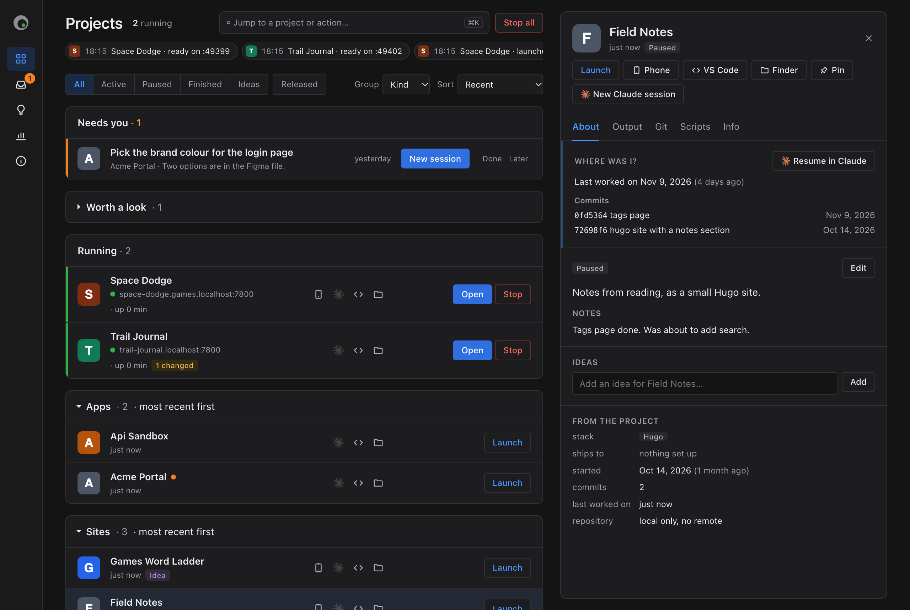
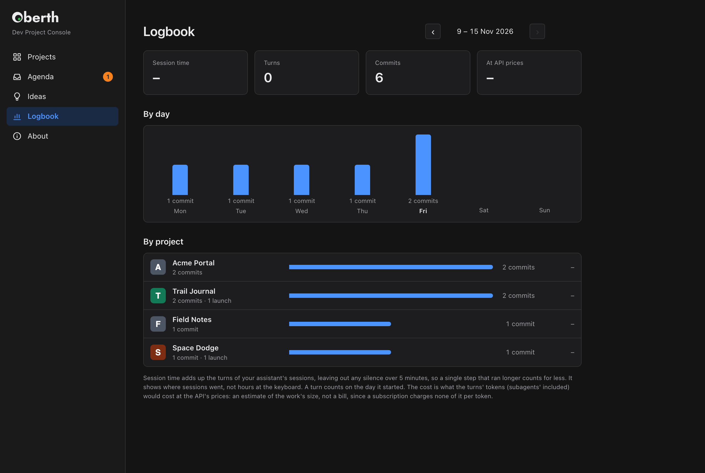

<p align="center"><picture><source media="(prefers-color-scheme: dark)" srcset="docs/logo/oberth-lockup-on-dark.svg"></picture></p>

<p align="center"><b>A local console for every project on your Mac.</b><br>
Start and stop dev servers, see what is running and what is waiting for you, and pick work back up where you left it.</p>

<p align="center"></p>

If you keep a folder full of side projects, you know the routine: which one was I on, how does this one start again, which port did it take, what did I leave half done. Oberth answers those from one page on `127.0.0.1` and a menu bar item, and it gives your coding agents the same view through a command-line client and an MCP server.

**Oberth is a starting point, not a product.** There is no installer and no settings screen. You clone it, and your own coding agent adapts it to your folders, stacks, editor, browser and AI assistant by following [CUSTOMIZE.md](CUSTOMIZE.md), a guide written for agents. Your copy is yours to change; nothing upstream needs to approve it.

## What it does

- **Finds your projects** in the folders you name, two levels deep, and knows how to start Vite and other npm, pnpm, Yarn or Bun dev scripts, Hugo sites, `serve.py`, static sites and Electron apps. Libraries show up too, without a Launch button. Anything else is one small launcher module or a `.oberth.json`.
- **Runs them** in their own process groups, notices when the page is up, opens it, shows the output with its colours, counts errors, and stops everything cleanly. A server you started in a terminal is recognised instead of started twice.
- **Gives each project a stable address**, `http://my-app.localhost:7700/`, whatever port its dev server takes, with hot reload passing through. Nothing to install, since macOS resolves `.localhost` itself.
- **Warns before a launch fails**: dependencies out of date with the lockfile, the wrong Node version, a missing `hugo` or virtual environment, a port already taken.
- **Keeps an About for each project**: your one-line description, a status (active, paused, finished, idea), a Released mark, and notes on where you left it. A paused project opens with a "Where was I?" card: your last prompt, what is uncommitted or unpushed, recent sessions and commits.
- **The Agenda** collects what is waiting for you: a Claude session blocked on a question, an ask an agent left you, unpushed work, notes older than the latest work, an issue from a stranger on a released project, a live site that went down.
- **The Logbook** keeps a permanent week-by-week history of commits, launches and assistant sessions, with the time they took, and reviews last week for you.
- **Search** finds an exact phrase across every project's code, docs and notes, and in what was said in past assistant sessions.
- **Ideas** is a notebook for later, filed from the dashboard, the menu bar, the CLI or an agent; starting one creates the folder, its About and a first session with the brief typed in.

Everything except the launcher can be turned off, and the assistant features work with Claude Code out of the box or not at all, until someone writes the few lines for another assistant.

<table>
<tr>
<td></td>
<td></td>
</tr>
</table>

## Try it

You need macOS, [Node.js](https://nodejs.org) 22.18 or newer, and for the menu bar app the Xcode Command Line Tools. The demo runs over made-up projects in a temporary folder, on its own port, and touches nothing else:

```bash
git clone <this repository> oberth && cd oberth
npm install
npm run demo
```

Then open <http://127.0.0.1:7790/>. Stop it with Ctrl+C.

## Make it yours

Open the clone with your coding agent and ask it to read [CUSTOMIZE.md](CUSTOMIZE.md) and set Oberth up for you. It will check that Oberth fits your Mac, interview you (where your projects are, how they start, your editor, browser and assistant, which parts you want), write your `config.json`, add what your stacks need, try it on other ports first, and install it once you agree.

Doing it by hand works too: write `~/Library/Application Support/oberth/config.json` ([docs/configuration.md](docs/configuration.md)), run `npm test`, then `bash scripts/install.sh`.

## Documentation

| | |
|---|---|
| [CUSTOMIZE.md](CUSTOMIZE.md) | Setting Oberth up for yourself, with recipes for new stacks, editors, assistants and links. Written for your agent. |
| [docs/configuration.md](docs/configuration.md) | Every field of `config.json`, project ids, modules, the state folder. |
| [docs/integrating-projects.md](docs/integrating-projects.md) | How projects are detected, `.oberth.json`, the CLI and MCP tools, About, asks and ideas. |
| [docs/agent-instructions.md](docs/agent-instructions.md) | A block for your agents' instruction file, so they keep Oberth current. |
| [docs/architecture.md](docs/architecture.md) | How it works, part by part, and its security model. |
| [AGENTS.md](AGENTS.md) | The code map and rules for agents changing Oberth itself. |

## How it is built

A Node service in TypeScript that Node runs directly (no build step, one runtime dependency), a dashboard in plain JavaScript with no framework, a single-file AppKit menu bar app, and a CLI and MCP server sharing one client. It listens on `127.0.0.1` only, checks the Host header against DNS rebinding, and requires a token for anything that acts or reveals code, logs or sessions. It never writes inside your projects. More in [docs/architecture.md](docs/architecture.md).

## Status and support

Oberth is used every day on one Mac, which is where it came from. It is shared as is: issues and pull requests are welcome, but there is no roadmap, no promise of compatibility between versions, and no guarantee anyone answers quickly. The Claude integration reads the Claude desktop app's private files, which an app update can change; when that happens, those features show nothing until the reader is fixed, and the rest keeps working.

## License

[MIT](LICENSE). The name and emblem are explained on the dashboard's About page; the wordmark is set in [Jost](https://fonts.google.com/specimen/Jost) (SIL Open Font License), interface icons come from [Tabler Icons](https://tabler.io/icons) (MIT), and the Claude mark from [Simple Icons](https://simpleicons.org) (CC0, a trademark of Anthropic).
